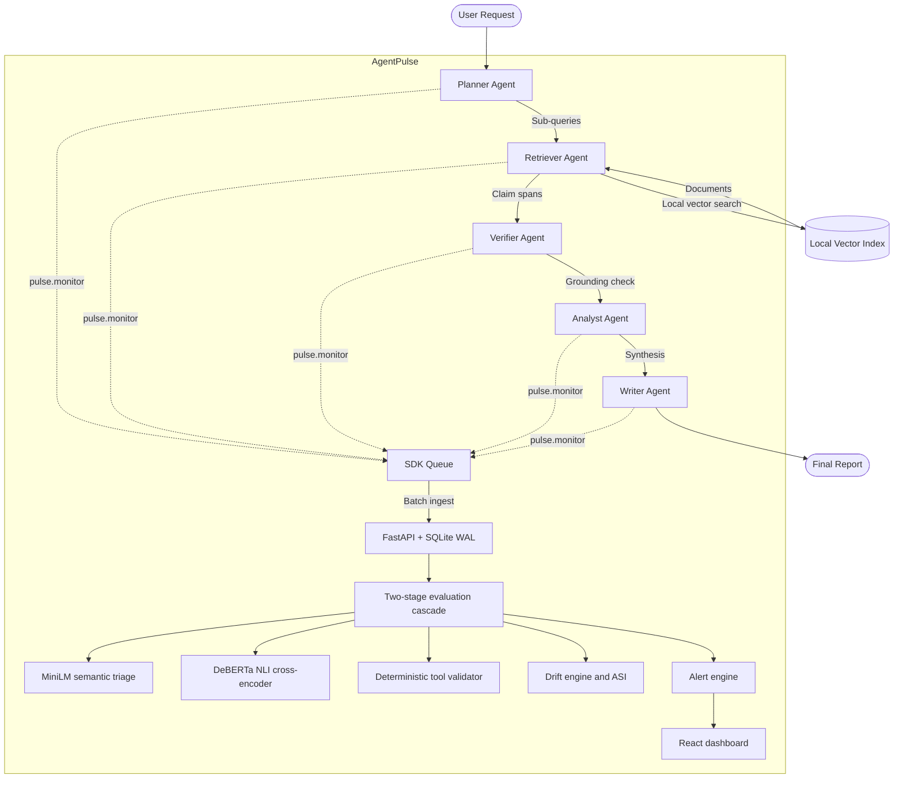

# AgentPulse: Master Product and Engineering Report

**Project title:** AgentPulse — A Lightweight, Self-Hostable Observability SDK for Continuous Grounding-Risk, Tool-Claim, and Drift Monitoring in Multi-Agent LLM Systems
**Category:** Industry-trend oriented, product-based AI engineering project
**Primary benchmark model:** `Qwen/Qwen3-8B` (Q4_K_M GGUF, local CPU inference via llama.cpp)
**Reasoning strategies evaluated:** Direct (zero-shot), Chain-of-Thought (CoT), Atom of Thoughts (AoT)
**Evaluation datasets:** `v1.0_dev`, `v1.0_val`, `v1.0_test` — 73 cases total (50 labeled via dual LLM-as-judge evaluation, 23 added by deterministic construction; see `LABEL_AGREEMENT_REPORT.md`). 68 of them are unique: `test_01` to `test_05` are copies of `dev_01` to `dev_05` (`GROUNDING_RECALIBRATION_2026-10.md`, section 0 item 8)
**Evaluation cascade:** `all-MiniLM-L6-v2` (bi-encoder embeddings) + `cross-encoder/nli-deberta-v3-small` (NLI)
**Hardware:** Windows x64, 16 logical / 8 physical CPU cores, no GPU
**Automated test suite:** 422 backend tests passing (`pytest tests/`, 5 min 36 s) and 136 dashboard tests in 13 files (`npx vitest run`), both run on `main` at `2fefb91` on 2026-10-25

## 1. Problem

Production multi-agent systems built on frameworks like LangGraph, AutoGen, or CrewAI chain together specialized agents for retrieval, tool execution, verification, and synthesis. Standard APM tools (Datadog, Prometheus, OpenTelemetry collectors) assume an HTTP 200 with a non-empty payload means the request succeeded. That assumption breaks for LLM pipelines, where the most damaging failures produce no runtime error at all:

- An upstream agent asserts a fabricated citation or finding; downstream agents accept it as fact and it propagates into a final report.
- An agent invokes a tool that returns 3 records, then writes "we verified 14 matching accounts" in its output. No exception is thrown.
- Two agents reach mutually exclusive conclusions from the same input.
- A prompt edit, temperature change, or retrieval corpus update causes a gradual semantic shift in outputs that degrades quality over weeks before anyone notices.

AgentPulse is an observability SDK and backend built to catch these specific failure modes, continuously, on every span rather than on a sampled subset.

## 2. Architecture



Design constraints:

- AgentPulse evaluates whether a claim is supported by its declared input context and tool records. It does not verify real-world truth independent of that context.
- The SDK is a pure observer. Reasoning strategy (Direct/CoT/AoT) is a property of the workload it watches, not something AgentPulse depends on internally.
- All inference runs locally (CPU or GPU) on open-source models. No data leaves the host by default.

The dashboard's operator loop (`CP[React dashboard]` above) was verified end-to-end with a real trace this session, not just loaded and eyeballed: ingest, an alert firing, curating that alert into a dataset via the UI, and reading the curated case back out. That surfaced and fixed four real bugs — a monitoring-critical one where the headline stat tiles read as permanently 0 in any background browser tab, a CORS/auth middleware ordering bug that broke every cross-origin request, an undocumented required env var that made dashboard writes fail silently, and a curation loop that wrote successfully but couldn't be read back. See `DASHBOARD_E2E_VERIFICATION_REPORT.md` for detail, including one gap open at the time: the Overview page's topology and waterfall visualizations were static fixtures. [2026-10-25: that dashboard was later replaced; the current one reads every figure from the API through `dashboard/src/lib/adapters.ts` and prints an em dash where the API has no value (see `CODE_WALKTHROUGH.md`, section 6).]

## 3. Risk aggregation

For a span with input context $C_{in}$, output $O_{out}$, and tool records $T$, the overall risk score is:

$$R(s) = \frac{w_g \cdot G(C_{in}, O_{out}) + w_t \cdot R_{\text{tool}}(T, O_{out})}{\sum \text{weights of signals present}}, \qquad G = P_{\text{contradiction}} + 0.3 \cdot P_{\text{neutral}}$$

This is what `_aggregate_risk()` in `backend/app/services/evaluator.py` computes today. Only signals present for a span contribute: the tool-claim term is included only when at least one claim was extracted, and the result is renormalized by the sum of the weights that did contribute, not divided by a fixed 1.0. $G$ is the grounding score from `backend/app/services/grounding.py` (`NEUTRAL_RISK_WEIGHT = 0.3` since `model_version` v1.2). A span is `high_risk` above 0.7 and `medium_risk` above 0.4.

Weights (initial heuristic values, not empirically calibrated):

| Weight | Value | Signal |
| :--- | :---: | :--- |
| $w_g$ | 0.40 | Grounding score $G$ |
| $w_t$ | 0.25 | Deterministic tool-claim mismatch |
| $w_d$ | 0.20 | Inter-agent disagreement: declared in `RISK_WEIGHTS` but **not summed**. The score is stored and shown, but it measured at chance on real traces (AUC 0.457 with the planner excluded, `SESSION_HANDOFF.md` 24.9.5) and its alert is withdrawn |
| $w_s$ | 0.15 | Semantic dissimilarity: declared, not summed |

[2026-10-25: an earlier version of this section put $P_{contradiction}$ and the disagreement term in the formula; `_aggregate_risk()` sums only the grounding score and the tool-claim score.]

The deterministic tool-claim signal ($w_t$) was benchmarked in isolation for the first time this session: 19 labeled cases against `evaluate_tool_claims`, precision 1.000 / recall 0.727 / F1 0.842. Two real bugs were found and fixed first — a partial tool-name match silently skipped the result-count check that the exact-match path already had, and the documented `RESULT_DISTORTION` mismatch type (claiming success when a tool call actually recorded an error) was never implemented, so such claims produced zero extracted claims and passed through unflagged. The remaining recall gap is three paraphrased/semantic claims with no lexical overlap with the validator's pattern list — an expected limitation of a deliberately simple, regex-based, sub-millisecond check, not something worth chasing with more regex (that would just turn it into an under-tested reimplementation of the NLI grounding check elsewhere in the pipeline). Full detail in `TOOL_CLAIM_VALIDATOR_REPORT.md`.

**On real agent traces the same check found nothing.** On an external corpus of 500 sessions (8,353 prose spans, five models) it extracted zero claims, and on a real-data benchmark it scored precision, recall and F1 **0.000** against its own 0.842 (`TOOL_CLAIM_EXTERNAL_TEST_REPORT.md`, section 10; `COMPETITIVE_POSITIONING.md` 5.1). The 19 hand-written cases used the phrasing the regex expects, so they tested the regex against itself. In the shipped system the check fires only when an output states a count in digits, as the Telemetry Lab's tool-claim scenario does.

**The grounding score as shipped.** `grounding_score = contradiction_prob + 0.3 * neutral_prob` (`backend/app/services/grounding.py`, `NEUTRAL_RISK_WEIGHT = 0.3`), `high_risk` above 0.7 and `medium_risk` above 0.4. On the 30-case test split both cut-offs give precision 0.929, recall 1.000, F1 0.963 [0.897, 1.000] and FPR 0.059 (1 of 17 supported cases flagged); on the 47-case held-out pool (val plus the 25 test cases that are not copies of dev cases) F1 is 0.927 at 0.7 and 0.952 at 0.4, FPR 0.074 (2 of 27), and AUROC 0.996 [0.983, 1.000] (`GROUNDING_RECALIBRATION_2026-10.md` T3c, T3d, T3b, T3). Five of the 30 test cases copy dev cases. The 0.3 is a design choice, not a fit: weights 0.0 to 0.3 cannot be told apart on this data, and the only labelled case where a neutral weight matters at all is `val_17`.

How it got here. Until 2026-10-21 the code read DeBERTa's `entailment` and `neutral` outputs in swapped order (fixed in PR #69). On those swapped labels an earlier calibration concluded that DeBERTa calls verbatim text "neutral" and chose a weight of 0.5; on the corrected labels DeBERTa calls it *entailment* (0.9865), so that premise was inverted. The 0.5 calibration's published test figures (F1 0.703 / FPR 0.647 for the old formula, 0.963 / 0.059 for 0.5) become 0.839 / 0.294 and 0.897 / 0.176 on corrected labels, and the self-comparison case scores about 0.014 (old formula, derived) and 0.008 (weight 0.5, measured), not 0.989 and 0.496 (`GROUNDING_RECALIBRATION_2026-10.md` section 3.3, T8b). The re-measurement found that the weight does not change ranking (AUROC equal for weights 0.0 to 0.8) and only decides where the medium line falls; 0.5 flagged 7 of 17 supported test cases as medium, 0.3 flags 1. PR #89 set 0.3. `GROUNDING_SCORE_CALIBRATION_REPORT.md` is kept as the historical record.

## 4. Reasoning strategy comparison: Direct vs CoT vs AoT

Real local inference via `Qwen/Qwen3-8B-GGUF` (Q4_K_M, llama.cpp, CPU-only, 16 logical cores, no GPU). Full run: 30 test cases x 5 stochastic runs x 3 strategies, `max_tokens=200` per call.

A prior version of this section reported latencies of 0.04-0.15 ms for this comparison. Those numbers were the output of a deterministic fallback text generator, not model inference — `load_immediately` was never set to `True` anywhere in the codebase, so no model weights were ever loaded for that run. That bug is fixed (see `experiments/reasoning_strategies.py`); the numbers below are from the real, completed run.

| Strategy | Mean latency (ms) | Median (ms) | Std dev (ms) | Mean tokens in | Mean tokens out | Mean grounding risk | Risk std dev | Contradiction rate |
| :--- | :---: | :---: | :---: | :---: | :---: | :---: | :---: | :---: |
| DIRECT | 11564.1 | 6044.7 | 13667.7 | 53.1 | 37.5 | 0.424 | 0.377 | 0.133 |
| COT | 45422.7 | 47682.3 | 7549.1 | 88.1 | 186.4 | 0.283 | 0.324 | 0.127 |
| AOT | 85215.2 | 74577.1 | 36663.8 | 543.4 | 319.7 | 0.233 | 0.331 | 0.000 |

**Grounding risk is inconclusive on this sample**: the spread between strategy means (0.191) is smaller than the largest within-strategy run-to-run standard deviation (0.377), so no strategy can be declared better on grounding risk here — this is reported as-is rather than picking the lowest mean and calling it a finding. What the data does support: DIRECT is fastest and cheapest (37.5 mean output tokens), AOT is slowest and most expensive (319.7 mean output tokens, ~8.5x DIRECT's), and AOT had zero contradictions across all 150 runs versus DIRECT's 13.3% and COT's 12.7% — a real, measured difference, distinct from the inconclusive risk-score comparison. Full detail and limitations in `REASONING_STRATEGY_EVALUATION_REPORT.md`.

**A GPU repeat of this benchmark was attempted and discarded.** The same 30x5x3 run was executed on a Kaggle P100 (`kaggle/agentpulse_reasoning_benchmark.ipynb`, `n_gpu_layers=-1` full offload) to compare against the CPU numbers above. It completed without crashing, but its output was invalid: all 450 grounding-risk values came back as exactly `0.0`, which is not a plausible NLI outcome across 30 varied cases. Root cause: `backend/app/services/grounding.py`'s `load_models()` is deliberately fail-open (evaluation errors are caught, logged, and return `None` rather than raising, so a grounding failure never blocks the pipeline in production), but the notebook's benchmark loop did `eval_res.overall_risk_score or 0.0` — turning a silently failed evaluation into a value indistinguishable from a genuine zero-risk result. The Kaggle execution log needed to see the actual load exception downloaded empty, so the specific cause (likely a dependency version pulled in by the notebook's `pip install -e backend` step, or a `cache_dir` path issue) was not identified. Latencies from the same run were also inconsistent with real GPU offload (slower than the CPU run on every strategy), a further sign something in that environment was broken, not just the grounding step. Rather than publish a comparison built on data with a known-broken half, this run's output was discarded. If revisited, the notebook should assert `grounding.models_loaded()` before the benchmark loop instead of silently defaulting missing scores to zero.

**The revisit happened, with the recommended fix, and produced a valid comparison.** A Llama 3.1 8B run on the same Kaggle P100 setup, with the `grounding.models_loaded()` fail-loud assertion added, passed model-load verification and produced varied, non-zero grounding-risk scores across the full range — a genuine result, not a repeat of the discarded run above. Headline finding, reported as-is rather than smoothed into a clean story: Llama on GPU is *slower* than Qwen on CPU on every strategy, in both raw latency and tokens/sec (e.g. AOT: 3.752 tok/s Qwen/CPU vs. 2.228 tok/s Llama/GPU) — the same direction as the discarded attempt, but this time backed by valid data, so it reads as a real property of this setup rather than a broken pipeline. Grounding-risk ordering (DIRECT highest, AoT lowest) held across both models. Full side-by-side tables, the tokens/sec methodology, and limitations (this mixes hardware *and* model, so it isn't a controlled ablation) are in `GPU_VS_CPU_BENCHMARK_REPORT.md`.

## 5. Baseline and ablation comparison

Ablation configurations were evaluated with thresholds selected on the development split (`v1.0_dev`, 21 cases) and reported on the held-out test split (`v1.0_test`, 30 cases) — no threshold was selected using test-split results. Full methodology in `THRESHOLD_ANALYSIS.md`.

| Configuration | Precision | Recall | F1 | FPR | FNR | Latency (ms) |
| :--- | :---: | :---: | :---: | :---: | :---: | :---: |
| A: MiniLM embedding only | 0.733 | 0.846 | 0.786 | 0.235 | 0.154 | 19.10 |
| B: DeBERTa NLI only | 0.929 | 1.000 | 0.963 | 0.059 | 0.000 | 132.09 |
| C: MiniLM + DeBERTa cascade | 0.929 | 1.000 | 0.963 | 0.059 | 0.000 | 151.19 |
| D: NLI + tool-claim validation | 0.929 | 1.000 | 0.963 | 0.059 | 0.000 | 132.13 |
| E: NLI + inter-agent disagreement | 0.929 | 1.000 | 0.963 | 0.059 | 0.000 | 281.02 |
| F: NLI + drift signal | 0.448 | 1.000 | 0.619 | 0.941 | 0.000 | 145.58 |
| G: Full AgentPulse pipeline | 0.812 | 1.000 | 0.897 | 0.176 | 0.000 | 165.18 |

Accuracy for A to F is from `experiments/results/ablation_results.json` and uses `contradiction_prob` or similarity only, so the label-order fix does not touch it. Config G runs the full pipeline, whose risk uses the grounding score: the file records 0.929 / 1.000 / 0.963 / 0.059, computed on swapped labels at weight 0.5; the row above is the same run re-scored on corrected labels (`GROUNDING_RECALIBRATION_2026-10.md` T8). G has not been re-run at the shipped weight 0.3.

Latency is the per-case mean in milliseconds from the 2026-09-18 run of `experiments/ablation.py` (`experiments/results/ablation_results.json`), on the PyTorch path (`load_models(use_onnx=False)`), one run, CPU only. For A to F it is the sum of the per-case timings of the signals each configuration uses, so C is A plus B by construction (19.10 + 132.09 = 151.19); G is timed separately by running the full `EvaluationPipeline` over the 30 cases. The 2026-08-23 run of the same script recorded 27.8 / 188.1 / 215.9 / 188.1 / 373.5 / 207.7 / 241.6 ms for A to G with identical accuracy; the cause of the difference was not identified, so the two runs together show how far a single latency figure here can move.

Configuration E produces metrics identical to Config B on this dataset: it collapses to B because the dataset's evaluation cases are single-agent records, so the only pair available to the disagreement engine is the same evidence-to-claim comparison NLI already makes. F scores below the plain NLI-only baseline because the drift detector's cold-start centroid, computed over case-file order rather than real temporal traffic, flags most of the non-failure test cases — this is not a subtle effect: F's false positive rate is 0.941. This limitation is analyzed in `THRESHOLD_ANALYSIS.md`. G (the full pipeline) scores below B on corrected labels (F1 0.897 against 0.963): its risk uses the grounding score at weight 0.5 with a 0.50 flag line, so two supported test cases that the NLI model calls neutral (`test_03`, `test_16`, 0.5007 and 0.5010) cross it. A-F use `contradiction_prob` directly. The first committed G (F1 0.703 / FPR 0.647) pre-dated the 0.5 weight.

Threshold sensitivity: every combination swept on the development split (semantic floor 0.10-0.40, NLI contradiction threshold 0.50-0.80) tied at F1 = 1.0. At 21 development cases, the sweep does not currently discriminate between thresholds; a larger development set is needed before threshold selection here is meaningful.

## 6. Compounding error: control vs intervention

Five-node pipeline (A through E) with a fabricated claim injected at Node B, evaluated under two conditions (`experiments/compounding_error.py`):

| Node | Condition A — unmitigated (risk / contradiction prob) | Condition B — verifier intervenes (risk / contradiction prob) |
| :--- | :---: | :---: |
| A: Planner | 0.008 / 0.002 | 0.008 / 0.002 |
| B: Retriever (fault injected) | 1.000 / 1.000 | 1.000 / 1.000 |
| C: Verifier | 0.996 / 0.992 | 0.504 / 0.009 |
| D: Analyst | 0.996 / 0.992 | 0.500 / 0.000 |
| E: Writer | 0.996 / 0.992 | 0.500 / 0.000 |

Risks are the corrected-label re-run at weight 0.5 (`experiments/results/grounding_recalibration_2026-10-22_compounding.json`, which ran the real `compounding_error.py` function); the published table (0.495 / 0.992 / 0.009 / 0.001) was computed with the swapped labels. Mean downstream risk after the fault node: 0.996 unmitigated, 0.501 once the verifier intervenes. The contradiction probability, which does not depend on the label order, drops from 0.992 to 0.009 or less, so a caught contradiction stops propagating in this pipeline; it is a propagation measurement, not a proof that verification always catches faults in general. But the intervening nodes are not "clean": their outputs (the verifier's correction and what follows it) are *neutral* against the faulty premise (neutral probability 0.99 or more), so at weight 0.5 they scored `medium_risk`. At the shipped weight 0.3 the same stored probabilities give 0.306, 0.300 and 0.300 (`low_risk`) for C, D and E and 0.006 for A (derived: contradiction + 0.3 × neutral; not re-run).

Node A compares the base premise with itself. DeBERTa calls that *entailment* (0.9865), so it scores 0.008. An earlier version of this paragraph explained a 0.495 here as DeBERTa calling self-comparison "neutral"; that explanation came from the swapped labels and was wrong.

## 7. Drift detection with negative controls

Eleven scenarios covering graded positive shifts (10%, 25%, 50%) and negative controls (`experiments/drift_scenarios.py`):

Two distinct quantities: **shift level** is the configured magnitude of each synthetic scenario, a parameter rather than a measurement; **centroid distance** is the measured cosine distance from the agent's baseline, which is what the 0.30 threshold applies to. Detection fires when `centroid_distance >= 0.30` **or** `stability_index < 70`.

[2026-10-25: this experiment measured the per-output distance the detector used in August. The shipped `DRIFT_DETECTED` rule reads `window_centroid_distance` instead: the cosine distance between the mean embedding of an agent's first 20 outputs and of its latest 12, alert above 0.30. On a held-out split of an external real-trace corpus, measured once, it gave 1.5% false alarms and 91.9% detection, but only 24.5% of sessions were long enough to report a distance (`DRIFT_REAL_TEXT_DIAGNOSIS_REPORT.md` 11.3 and 11.5).]

| Scenario | Type | Shift level | Centroid distance (measured) | Is anomaly | Detected | False alert | Time to detect | Final ASI |
| :--- | :--- | :---: | :---: | :---: | :---: | :---: | :---: | :---: |
| Prompt formatting change | prompt_drift | 0.10 | 0.001 | No | No | No | — | 100.0 |
| Prompt tone shift | prompt_drift | 0.25 | 0.007 | No | No | No | — | 99.7 |
| Prompt template rewrite | prompt_drift | 0.50 | 0.042 | **Yes** | **No** | No | — | 98.5 |
| Model version update | model_drift | 0.50 | 0.042 | **Yes** | **No** | No | — | 98.5 |
| Temperature shift (0.1 to 0.9) | hyperparam_drift | 0.35 | 0.017 | **Yes** | **No** | No | — | 99.4 |
| Tool frequency fluctuation | tool_entropy | 0.25 | 0.007 | No | No | No | — | 99.7 |
| Uncalibrated external tool | tool_entropy | 0.60 | 0.064 | Yes | Yes | No | 1 span | 82.7 |
| Hallucination burst | quality_regression | 0.75 | 0.099 | Yes | Yes | No | 1 span | 96.5 |
| Negative control: paraphrasing | negative_control | 0.12 | 0.001 | No | No | No | — | 100.0 |
| Negative control: valid tool substitution | negative_control | 0.15 | 0.002 | No | No | No | — | 99.9 |
| Negative control: invariant flow | negative_control | 0.00 | 0.000 | No | No | No | — | 100.0 |

**Detection recall on anomalies is 0.400 — 2 of 5 were detected**, both on the first shifted span. The three misses are the 50% prompt-template rewrite, the model-version change, and the temperature shift. Across all 11 scenarios there were **zero false alerts**, including the three negative controls: on this set the detector is conservative rather than accurate.

Both detections came from the tool-entropy and quality-regression signals, not the embedding centroid. **No scenario's measured centroid distance exceeded 0.099**, so the 0.30 threshold was never reachable here and remains untested by this experiment — and the three missed anomalies are exactly the semantic output drift that signal exists to catch. Whether the gap lies in the detector or in scenario construction (`experiments/drift_scenarios.py` builds vectors directly rather than embedding real drifted text) is not determined by this data. Full detail, limitations, and a correction notice covering earlier inaccuracies in this section are in `DRIFT_EXPERIMENT_REPORT.md`.

## 8. Dataset and label agreement

| Split | Cases | Observed agreement | Expected chance agreement | Cohen's kappa |
| :--- | :---: | :---: | :---: | :---: |
| v1.0_dev (dual-evaluated subset) | 15 | 0.933 | 0.48 | 0.871 |
| v1.0_val (dual-evaluated subset) | 15 | 0.933 | 0.48 | 0.871 |
| v1.0_test (dual-evaluated subset) | 20 | 1.000 | 0.50 | 1.000 |
| Overall (dual-evaluated) | 50 | 0.960 | 0.49 | 0.922 |

These 50 cases were labeled by two independent LLM-as-judge evaluation passes under an explicit taxonomy, not by independent human annotators — see `LABEL_AGREEMENT_REPORT.md` for exactly what this does and doesn't establish. A further 23 cases were added later (bringing the three splits to 21/22/30, 73 total) using deterministic construction — ground truth follows mechanically from how each case was built (e.g. a claimed tool-result count that differs from the actual `tool_records` entry), rather than from any evaluator judgment. These 23 cases are not included in the kappa figures above.

## 9. Test suite

Run on `main` at `2fefb91`, 2026-10-25, Windows 11, the project venv:

```
pytest tests/ -q
422 passed, 7 warnings in 335.91s (0:05:35)

cd dashboard && npx vitest run
Test Files  13 passed (13)
     Tests  136 passed (136)
```

The 7 warnings are a `torch.jit.script` deprecation notice from one truncation test. The suite loads the real models for the tests that need them (`AGENTPULSE_MODEL_CACHE_DIR` pointed at the cached weights, `HF_HUB_OFFLINE=1`).

## 10. Anticipated questions

**What do the latency numbers in Section 4 actually measure, given the earlier fake ones?**
The earlier 0.04-0.15 ms figures were a deterministic string-template fallback, not model output — confirmed by grepping the codebase for `load_immediately=True`, which appeared nowhere. The fix wires a real GGUF model through llama.cpp, and the run has completed: Section 4's latencies (11.6 s to 85.2 s mean per strategy) are real Qwen3-8B inference on CPU.

**Why do drift and the full pipeline score worse than plain NLI in the ablation table?**
Two different reasons. Drift (F): the detector's centroid is cold-started over the case list's file order, which has no real temporal structure, and it flags most non-failure cases as anomalous when folded into the score. That is a finding about the drift-in-composite design, not about drift detection itself (Section 7 and `DRIFT_REAL_TEXT_DIAGNOSIS_REPORT.md`). The full pipeline (G): on corrected labels it ran at a neutral weight of 0.5 with a 0.50 flag line, so two supported answers the NLI model calls neutral crossed it (Section 5). It has not been re-run at the shipped 0.3.

**Is Cohen's kappa of 0.922 evidence the labeling scheme is reliable in general?**
It is evidence of agreement between two independent LLM-as-judge evaluation passes on 50 specific cases across three domains, using an explicit labeling taxonomy — not evidence of human-verified ground truth. It says nothing about the 23 deterministically-constructed cases (which don't need it, since their labels aren't a judgment call), and it does not extend to unseen production traffic, or substitute for human review, without further work.

**Does Atom of Thoughts improve grounding over Chain-of-Thought?**
Not shown. The real-inference run completed (Section 4): AoT had the lowest mean grounding risk (0.233 against 0.283 for CoT) and no contradictions in 150 runs, but the spread between strategy means is smaller than the run-to-run standard deviation, so the risk ordering is inconclusive. Those risks were also computed before the label-order fix (`GROUNDING_RECALIBRATION_2026-10.md` section 1, row 7) and were not re-run.

**Do the inter-agent disagreement and tool-claim checks work?**
Not on real data, and the report says so. Disagreement detected 0 of 10 independently labelled contradictions on real multi-agent traces, and with the planner excluded it measured at chance (AUC 0.457); its alert is withdrawn and its score is stored only (`COMPETITIVE_POSITIONING.md` 5.2, `SESSION_HANDOFF.md` 14.1 and 24.9.5). Tool-claim scored F1 0.000 on real traces (Section 3). Drift is the signal that held up on external data, with the coverage caveat in Section 7.
